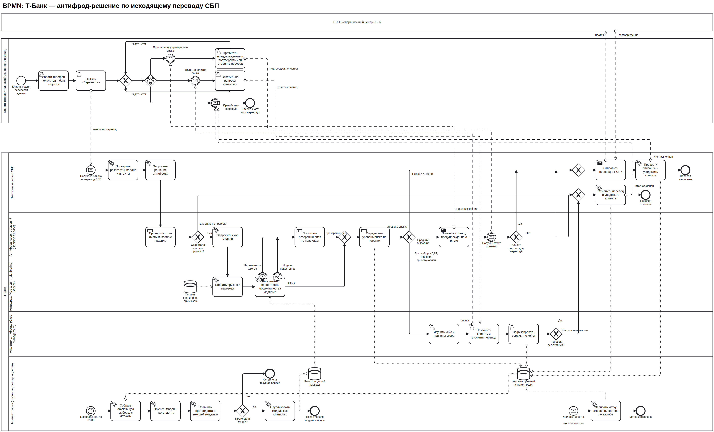

# Т-Банк: антифрод-решение по исходящему переводу СБП

Домашнее задание к семинару 13: архитектурные схемы ML-системы (BPMN + C4).

> **Процесс.** Клиент Т-Банка отправляет перевод по номеру телефона через СБП из мобильного приложения.
> До отправки платежа в НСПК антифрод-система принимает по переводу одно из четырёх решений:
> **пропустить**, **запросить подтверждение у клиента**, **приостановить до проверки аналитиком** или **отклонить**.
> Процесс заканчивается конкретным результатом: перевод выполнен или отклонён, а клиент получил уведомление об итоге.

## 1. Компания, процесс и границы работы

| | |
|---|---|
| **Компания** | Т-Банк |
| **Процесс** | Решение антифрода по одному исходящему переводу СБП (C2C, по номеру телефона) из мобильного приложения |
| **Триггер** | Клиент нажал «Перевести» |
| **Результат** | Перевод выполнен или отклонён, клиент знает итог. Решение и исход записаны как метка для следующего обучения модели |
| **Место модели** | Задача BPMN «Рассчитать вероятность мошенничества моделью» в дорожке *ML-скоринг*, контейнер C4 **ML Scoring Service** |

**Входит в схемы:**
- сквозной путь перевода от нажатия «Перевести» до итога: проверки, жёсткие правила, ML-скоринг, пороги, развилка из трёх уровней риска;
- запасные пути: таймаут или недоступность модели (переход на резервные правила), подтверждение клиентом, ручная проверка аналитиком;
- петля обратной связи: решения, вердикты аналитиков и жалобы клиентов попадают в журнал меток, а еженедельное переобучение публикует новую версию модели в реестр;
- контейнеры, без которых этот путь не объясняется: откуда берутся признаки, где лежит модель, куда уходит ответ и метки.

**Сознательно оставлено за рамками:**
- входящие переводы, переводы по карте и реквизитам, переводы юрлиц;
- аутентификация клиента и вход в приложение, антифрод на уровне сессии (вредоносное ПО, удалённый доступ), отдельные модели устройства;
- технические отказы платёжного сервиса (нет денег на счёте, превышен лимит, НСПК недоступна): на схеме это одна задача «Проверить реквизиты, баланс и лимиты», её отказная ветка не нарисована;
- таймауты на стороне человека: клиент не ответил на предупреждение, аналитик не дозвонился. Эти ветки описаны текстом в допущениях, а на схему не вынесены, чтобы не перегружать её;
- мониторинг дрейфа, A/B-тесты моделей, инфраструктура (Kubernetes, сеть, секреты), процесс разработки правил.

## 2. Какую задачу решает модель

| | |
|---|---|
| **Тип задачи** | Бинарная классификация: перевод мошеннический (клиента обманули или действуют без его согласия) или легитимный |
| **Вход** | Поля перевода (сумма, время, банк и телефон получателя, устройство, IP, канал), онлайн-агрегаты из Feature Store (история отправителя: средний чек, число переводов за 1 ч и 24 ч, новый ли получатель; история получателя: сколько разных отправителей прислали ему деньги за 24 ч; устройство: смена за последние 24 ч) |
| **Выход** | `p` — вероятность мошенничества от 0 до 1, `model_version`, `reason_codes` (топ-5 признаков по SHAP) |
| **Кто использует выход** | **Decision Service** превращает `p` в уровень риска по порогам. `reason_codes` показываются **аналитику** в карточке кейса |
| **Что нужно бизнесу** | Поймать как можно больше мошеннических переводов (recall в рублях) и при этом редко беспокоить честных клиентов: доля переводов с предупреждением или приостановкой не выше заданного бюджета. Ответ нужно уложить в SLA синхронного платежа |

### Пороги и запасные пути (заданы мной, см. допущения)

| Ситуация | Что делает процесс | Шлюз / событие на BPMN |
|---|---|---|
| Сработало жёсткое правило: получатель в стоп-листе или в базе ФинЦЕРТ | Отказ, модель не вызывается | ветка «Да» шлюза «Сработало жёсткое правило?» |
| `p < 0,30` (низкий риск) | Перевод уходит в НСПК без вмешательства | ветка «Низкий» шлюза «Уровень риска?» |
| `0,30 ≤ p < 0,85` (средний риск) | Клиенту показывается предупреждение о риске, перевод идёт только после повторного подтверждения | ветка «Средний» шлюза «Уровень риска?», затем шлюз «Клиент подтвердил перевод?» |
| `p ≥ 0,85` (высокий риск) | Перевод приостановлен, открыт кейс, аналитик звонит клиенту и ставит вердикт | ветка «Высокий» шлюза «Уровень риска?», затем шлюз «Перевод легитимный?» |
| **Модель не ответила за 150 мс** (граничное событие-таймер) | Запасной путь: **резервные правила** считают `p_rule`, дальше тот же шлюз порогов | событие «Нет ответа за 150 мс», затем задача «Посчитать резервный риск по правилам» |
| **Модель недоступна** (граничное событие-ошибка: сервис вернул `UNAVAILABLE` или модель не загружена) | Тот же запасной путь | событие «Модель недоступна», затем задача «Посчитать резервный риск по правилам» |
| Новая версия модели не загрузилась или не прошла проверку схемы признаков | Скоринг остаётся на **предыдущей версии** модели | внутри ML Scoring Service, компонент *Model Version Selector* (C4 Components) |

Резервные правила (`p_rule`) подобраны так, чтобы ответ попадал в те же уровни риска:
- `0,9`, если сумма > 100 000 ₽, получатель новый и устройство сменилось за последние 24 ч;
- `0,5`, если сумма > 30 000 ₽ и получатель новый (за 180 дней переводов ему не было);
- `0,1` в остальных случаях.

### Петля обратной связи: откуда метки

| Источник метки | Как попадает в журнал | Где на BPMN |
|---|---|---|
| Скор, версия модели, решение | Decision Service публикует в Kafka `af.decisions`; DWH читает событие | ассоциация между «Определить уровень риска по порогам» и «Журнал решений и меток (DWH)» |
| Исход перевода: выполнен или отклонён | Платёжный сервис публикует в Kafka `transfers`; DWH читает событие | ассоциации от «Провести списание…» и «Отменить перевод…» |
| Вердикт аналитика (fraud / legit) | Case Management публикует в Kafka `af.case_verdicts`; DWH читает вердикт как метку | ассоциация между «Зафиксировать вердикт по кейсу» и DWH |
| Жалоба клиента «меня обманули» (может прийти через дни или недели) | CRM передаёт жалобу в Label Collector; тот публикует метку в Kafka `af.labels`, которую читает DWH | старт по сообщению «Жалоба клиента о мошенничестве», затем задача «Записать метку «мошенничество» по жалобе» |

Положительная метка ставится по вердикту аналитика «мошенничество» или по жалобе. Отрицательная метка ставится, если по выполненному переводу за 30 дней не пришло жалобы. Еженедельный пайплайн (таймер «Еженедельно, вс 03:00») берёт только «созревшие» переводы, обучает претендента, сравнивает его с текущей моделью и при успехе переводит на него алиас `champion` в реестре. ML Scoring Service подхватывает новый алиас сам.

## 3. Кто получает результат модели

- **Decision Service** получает `p` напрямую и превращает его в решение.
- **Платёжный сервис СБП** получает решение «пропустить / отклонить» и проводит или отменяет перевод.
- **Клиент-отправитель** при среднем риске видит предупреждение, при высоком получает звонок аналитика. В любом случае ему приходит итог перевода.
- **Аналитик антифрода** получает кейс со скором и `reason_codes`.
- **ML-платформа** (Training Pipeline) читает из DWH скоры, вердикты аналитиков и жалобы для подготовки обучающей выборки.

## 4. Схемы: файлы и чем открыть

| Схема | Исходник (текст) | Картинки | Чем открыть исходник |
|---|---|---|---|
| BPMN сквозного процесса | [`diagrams/bpmn/sbp-antifraud-process.bpmn`](diagrams/bpmn/sbp-antifraud-process.bpmn) | [`.png`](diagrams/bpmn/sbp-antifraud-process.png), [`.svg`](diagrams/bpmn/sbp-antifraud-process.svg) | BPMN 2.0 XML с координатами: [demo.bpmn.io](https://demo.bpmn.io/) (перетащить файл), Camunda Modeler, плагин BPMN для diagrams.net |
| C4 L1 · System Context | [`diagrams/c4/01-context.puml`](diagrams/c4/01-context.puml) | [`.png`](diagrams/c4/01-context.png), [`.svg`](diagrams/c4/01-context.svg) | PlantUML + стандартная библиотека C4-PlantUML: плагин PlantUML для VS Code или IntelliJ, [plantuml.com/plantuml](https://www.plantuml.com/plantuml) |
| C4 L2 · Containers | [`diagrams/c4/02-containers.puml`](diagrams/c4/02-containers.puml) | [`.png`](diagrams/c4/02-containers.png), [`.svg`](diagrams/c4/02-containers.svg) | так же |
| C4 L3 · Components ML-блока | [`diagrams/c4/03-components-ml-scoring.puml`](diagrams/c4/03-components-ml-scoring.puml) | [`.png`](diagrams/c4/03-components-ml-scoring.png), [`.svg`](diagrams/c4/03-components-ml-scoring.svg) | так же |

**Пересобрать картинки из исходников:** `make c4` (PlantUML в Docker), `make bpmn` (bpmn-js в headless Chrome, Node.js 18+, скрипт [`tools/render_bpmn.js`](tools/render_bpmn.js)) или `make` для обеих.

**Легенда.** На C4 используются стандартные обозначения C4-PlantUML, легенда выводится на каждой диаграмме через `SHOW_LEGEND()`. Тёмно-синий — люди, синий — наша система и её контейнеры, голубой — компоненты, серый — внешние системы и контейнеры, цилиндры — хранилища, «труба» — очередь сообщений. На BPMN используются стандартные обозначения BPMN 2.0, своих значков нет:
- шестерёнка — сервисная задача, человечек — пользовательская задача, таблица — задача бизнес-правил, конверт — отправка;
- сплошная линия показывает поток управления, пунктир с кружком показывает сообщение между пулами, точечная линия показывает чтение или запись в хранилище данных;
- двойной круг на краю задачи — граничное событие (таймер, ошибка), ромб с пятиугольником — шлюз по событию.

### Уровни схем

- **BPMN** — один сквозной процесс. Три пула: *НСПК* (свёрнутый), *Клиент-отправитель* и *Т-Банк*. В пуле Т-Банка пять дорожек: платёжный сервис, сервис решений, ML-скоринг, аналитик, ML-платформа. Отдельными стартовыми событиями внутри банка показаны еженедельное переобучение и приём жалобы. Это та же петля обратной связи, только запускается она своими событиями.
- **C4 Context** — одна система «Антифрод-система СБП-переводов», вокруг неё 2 человека и 5 внешних систем. Внутреннее устройство не раскрыто.
- **C4 Containers** — 11 контейнеров внутри границы системы, у каждого указана технология. Путь процесса: признаки берутся из Online Feature Store, который наполняет Flink. Модель публикуется в реестр MLflow, откуда её загружает ML Scoring Service. Ответ уходит в Decision Service и дальше в платёжный сервис. Решения и метки идут через Kafka в DWH, откуда их читает Training Pipeline.
- **C4 Components** — только внутреннее устройство ML Scoring Service. Вокруг показаны лишь те контейнеры, с которыми он связан напрямую: Decision Service, Feature Store, реестр моделей, Kafka. Остальные контейнеры на эту схему не перенесены.
  - признаки: *Feature Assembler* обращается к Online Feature Store через *Feature Store Client*;
  - выбор версии модели: *Model Loader* загружает из реестра модель с алиасом `champion`, а *Model Version Selector* выбирает рабочую версию. Если новая версия не загрузилась, остаётся предыдущая;
  - расчёт ответа: *Inference Engine* (CatBoost) и *Reason Codes Builder* (SHAP);
  - возврат в бизнес-процесс: *Scoring API* передаёт ответ в Decision Service, то есть BPMN-задача «Определить уровень риска по порогам». Копия ответа уходит через *Score Logger* в Kafka для журнала меток.

## 5. Соответствие BPMN и C4

| Задача / событие BPMN (дорожка) | Контейнер C4 (L2) | Компонент C4 (L3) |
|---|---|---|
| «Нажать «Перевести»», «Прочитать предупреждение…», «Ответить на вопросы аналитика» (пул Клиента) | внешняя система *Мобильное приложение Т-Банка* | — |
| «Получена заявка…», «Проверить реквизиты, баланс и лимиты», «Запросить решение антифрода», «Отправить перевод в НСПК», «Провести списание…», «Отменить перевод…» (Платёжный сервис СБП) | внешняя система *Платёжный сервис СБП* (за пределами антифрод-системы) | — |
| «Проверить стоп-листы и жёсткие правила» (Сервис решений) | **Decision Service** (+ данные из *Базы ФинЦЕРТ*) | — |
| «Запросить скор модели» (Сервис решений) | **Decision Service** вызывает ML Scoring Service | — |
| «Собрать признаки перевода» (ML-скоринг) | **ML Scoring Service** + **Online Feature Store** | Feature Assembler, Feature Store Client |
| **«Рассчитать вероятность мошенничества моделью»** (ML-скоринг), **место вызова модели** | **ML Scoring Service** (+ **Реестр моделей**) | Scoring API, Model Version Selector, Inference Engine, Reason Codes Builder |
| Граничные события «Нет ответа за 150 мс», «Модель недоступна» | таймаут gRPC в **Decision Service** / ответ `UNAVAILABLE` от **ML Scoring Service** | Scoring API (`/health/ready`) |
| «Посчитать резервный риск по правилам», «Определить уровень риска по порогам», шлюз «Уровень риска?» | **Decision Service** | — |
| «Показать клиенту предупреждение о риске», «Получен ответ клиента», шлюз «Клиент подтвердил перевод?» | **Decision Service** обменивается сообщениями с *Мобильным приложением* (push) | — |
| «Изучить кейс…», «Позвонить клиенту…», «Зафиксировать вердикт по кейсу», шлюз «Перевод легитимный?» (Аналитик) | **Case Management** + **Case DB** | — |
| Хранилище данных «Онлайн-хранилище признаков» | **Online Feature Store** (наполняет **Feature Streaming Job**) | (снаружи) Online Feature Store |
| Хранилище данных «Журнал решений и меток (DWH)» | **Журнал решений и меток (DWH)** через **Шину событий (Kafka)** | Score Logger записывает событие в Kafka |
| «Жалоба клиента о мошенничестве», «Записать метку «мошенничество» по жалобе» (ML-платформа) | *Служба поддержки (CRM)* передаёт жалобу в **Label Collector** | — |
| «Еженедельно, вс 03:00», «Собрать обучающую выборку…», «Обучить модель-претендента», «Сравнить претендента с текущей моделью», шлюз «Претендент лучше?» | **Training Pipeline** (читает DWH) | — |
| «Опубликовать модель как champion», хранилище данных «Реестр моделей (MLflow)» | **Training Pipeline** публикует модель в **Реестре моделей** | (снаружи) Model Loader читает Реестр моделей |
| Пул «НСПК» | внешняя система *НСПК* | — |

## 6. Допущения

Всё ниже нельзя узнать снаружи. Это моя реконструкция, а не внутренний регламент Т-Банка.

1. **Устройство процесса.** У банка есть отдельная антифрод-система. Платёжный сервис вызывает её синхронно до отправки платежа в НСПК и ждёт решения. *Допущение: внутренний регламент банка неизвестен.*
2. **Порядок проверок.** Сначала стоп-листы и жёсткие правила, потом модель. При срабатывании жёсткого правила модель не вызывается. *Допущение.*
3. **Работа с базой ФинЦЕРТ.** На схеме совпадение получателя с базой Банка России упрощено до «отказать». Как именно банк сочетает отказ, приостановку и уведомление клиента, снаружи не видно. *Допущение и упрощение.*
4. **Модель и стек.** Модель — градиентный бустинг (CatBoost) на табличных признаках. Сервис на Python/FastAPI, онлайн-признаки в Redis, стриминг на Flink, шина Kafka, DWH на ClickHouse, оркестрация Airflow, реестр MLflow + S3, Decision Service и Case Management на Java/Spring. *Все технологии — допущения*, выбраны как типовой стек для такой задачи.
5. **Пороги 0,30 и 0,85** и бюджет беспокойства (предупреждения и приостановки не больше ~1,5 % переводов). *Мои числа.* В реальности пороги подбирают по кривой precision-recall под бюджет аналитиков и допустимую нагрузку на клиентов.
6. **SLA:** 300 мс на всё решение, 150 мс таймаут скоринга, 20 мс на чтение признаков. *Допущение.*
7. **Резервные правила** при отказе модели и их пороговые значения (100 000 ₽, 30 000 ₽, 180 дней, 24 ч) придуманы мной.
8. **Предыдущая версия модели как запасной путь:** скоринг держит прошлую версию в памяти и остаётся на ней, если новая не загрузилась. *Допущение.*
9. **Средний риск = предупреждение + повторное подтверждение клиентом**, а не автоматический отказ. *Допущение*, опирается на то, что в приложениях банков встречаются предупреждения о возможном мошенничестве (см. источники).
10. **Высокий риск = приостановка и звонок аналитика.** Если клиент не подтверждает перевод или аналитик не дозвонился за отведённое время, перевод отменяется. Тайм-аут дозвона на схему не вынесен. *Допущение.*
11. **Клиент не ответил на предупреждение** за 15 минут — перевод отменяется. На схеме не показано. *Допущение.*
12. **Метки:** положительная — вердикт аналитика или жалоба клиента, отрицательная — выполненный перевод без жалобы за 30 дней. Отмену клиентом после предупреждения в положительные метки не берём, потому что она неоднозначна. *Допущение.*
13. **Смещение выборки:** переводы, отклонённые правилами, не получают исхода. Для обучения используются вердикты аналитиков и малая доля переводов среднего риска, которые прошли после подтверждения. Подробнее не прорабатывалось. *Допущение.*
14. **Критерий выпуска модели** («Претендент лучше?»): PR-AUC на отложенной выборке по времени (последние 2 недели созревших меток) выше текущей, recall при том же бюджете предупреждений не ниже, схема признаков совместима. Переобучение раз в неделю, в воскресенье в 03:00. *Допущение.*
15. **Жалобы** из службы поддержки приходят событием в Label Collector, связь с переводом — по его идентификатору. *Допущение.*

## 7. Источники и что придумано

**На что опирался:**
- Наблюдение за продуктом: перевод по номеру телефона через СБП в мобильном приложении. Видно форму перевода, выбор банка получателя, экраны предупреждений о возможном мошенничестве, приостановку подозрительных операций и звонки из службы безопасности.
- Публичная информация о регулировании: Федеральный закон № 161-ФЗ «О национальной платёжной системе», ст. 8 (обязанность банка выявлять операции без согласия клиента, в том числе по базе данных Банка России), и роль ФинЦЕРТ Банка России как оператора этой базы.
- Общая схема СБП: банк отправителя передаёт перевод в операционный центр НСПК, тот передаёт его банку получателя (открытые материалы НСПК и Банка России).
- Нотации: примеры BPMN Camunda — <https://camunda.com/bpmn/examples/>, модель C4 — <https://c4model.com/>, библиотека C4-PlantUML — <https://github.com/plantuml-stdlib/C4-PlantUML>.

**Что на схемах придумано мной.** Готовые схемы антифрода СБП Т-Банка в работе не использованы. Я разработал дорожки и задачи BPMN, порядок шагов, три уровня риска и пороги, резервные правила и таймауты, петлю разметки и критерий выпуска модели. Состав контейнеров, их технологии, топики Kafka, компоненты ML Scoring Service и связи между ними тоже придуманы для этой работы. Из реального мира взяты внешние участники (клиент, мобильное приложение, НСПК, ФинЦЕРТ, служба поддержки) и сам факт, что банк проверяет переводы на мошенничество до их проведения.

## Структура репозитория

- `README.md`: описание процесса, допущения и соответствие схем.
- `Makefile`: команды пересборки картинок.
- `diagrams/bpmn/`: исходник BPMN и его изображения в SVG и PNG.
- `diagrams/c4/`: исходники трёх уровней C4 и их изображения в SVG и PNG.
- `tools/`: скрипт и зависимости для визуализации BPMN.
